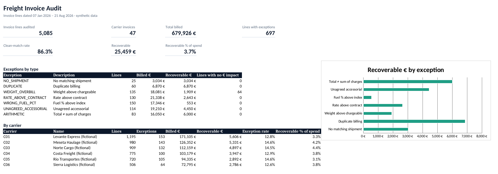

# Freight Invoice Auditor

Checks carrier invoice lines against contract terms and tells you **what was overbilled, why, and how much to claim back** — in under a second for 5,000 lines.



> **All data is synthetic.** Carriers, lanes, rates and shipments are generated by `data/generate_data.py`. No real company data is used.

## The problem

Freight invoices arrive by the thousands, line by line, and each one can be wrong in several ways: weight above what was shipped, a rate above the contract, the wrong month's fuel surcharge, extra charges nobody agreed to, the same shipment billed twice. Checking them by hand is slow, and small errors add up across a year of spend.

## What it does

Each invoice line is **re-rated from the shipment record and the contract**, then compared with what the carrier billed:

| Check | Rule |
|---|---|
| `NO_SHIPMENT` | Line refers to a shipment that does not exist |
| `DUPLICATE` | Shipment already billed on an earlier line |
| `WEIGHT_OVERBILL` | Billed weight > chargeable weight (max of actual kg and m³ × 333) + 1% |
| `RATE_ABOVE_CONTRACT` | Rate per kg above the rate card for that lane and weight band |
| `WRONG_FUEL_PCT` | Fuel % above the carrier's index for the ship month |
| `UNAGREED_ACCESSORIAL` | Extra charge not in the contract, not on the shipment, billed more times than used, or above the agreed price |
| `ARITHMETIC` | Total ≠ base + fuel + accessorials |

**Recoverable €** = billed − contract price, only on lines that are exceptions *and* overbilled. Duplicates and lines with no shipment are fully recoverable.

## Results on the sample data

| | |
|---|---|
| Invoice lines audited | 5,085 across 47 carrier invoices |
| Total billed | 679,926 € |
| Lines flagged | 697 (13.7%) |
| **Recoverable** | **25,459 € (3.7% of spend)** |
| Detection vs. planted errors | 697 / 697 caught, 0 false positives |

One finding worth noting: **64 weight overbills had no money impact**, because the shipment still fell under the lane's minimum charge. The auditor flags them (it is still a data-quality issue with that carrier) but does not claim money for them.

## Output

`output/audit_report.xlsx`
- **Summary** — KPIs, exceptions by type, recoverable € chart, carrier scorecard
- **Carrier claims** — amount to dispute per carrier invoice, with reasons
- **Exceptions** — every flagged line with billed vs. contract values
- **Method** — the rules, in plain language

`output/audit_results.csv` — one row per line with all checks, ready to load into Power BI or SQL.

## Run it

```bash
pip install -r requirements.txt
python data/generate_data.py   # build the synthetic dataset (data/raw/)
python run_audit.py            # audit it, write output/
python evaluate.py             # score the auditor against the planted errors
pytest -q                      # 11 unit tests, one per rule and edge case
```

Use your own files with `python run_audit.py --data path/to/csvs`. Column requirements are in `src/auditor/load.py`.

## What didn't work at first

The first version compared accessorial codes as **sets**: "is `TAIL_LIFT` on the shipment? yes → fine." It missed 2 of 114 planted accessorial errors, both cases where a valid charge was **billed twice** for a shipment that used it once. The fix counts units per code and also checks the amount against the contract price. There is now a test for exactly that case (`test_accessorial_billed_twice`).

## Limitations

- The synthetic data is clean apart from the planted errors, so 100% detection here does **not** mean 100% on real invoices. Real data adds messier problems: inconsistent lane names, missing volumes, scanned PDFs, contract changes mid-month.
- One error per line in the sample; real lines can have several (the auditor reports all of them, with a primary one).
- Road freight only (volumetric factor 333 kg/m³).

## Project structure

```
data/generate_data.py      synthetic rate card, fuel index, contracts, shipments, invoices
src/auditor/load.py        reads and validates input CSVs
src/auditor/audit.py       re-rating and the seven checks
src/auditor/report.py      Excel report
run_audit.py               command line entry point
evaluate.py                precision / recall against ground truth
tests/                     unit tests
```

## Stack

Python · pandas · openpyxl · pytest. Built with AI assistance (Claude).

## Next

The same dataset feeds a **SQL + Power BI** freight-audit dashboard (coming next).
